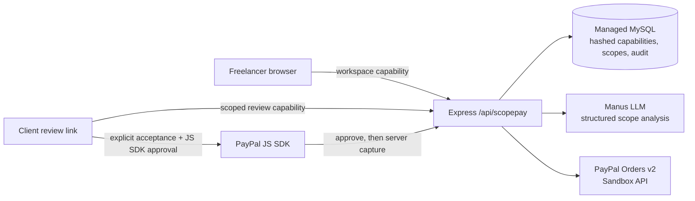

# ScopePay

**Turn scope creep into approved, paid work.** ScopePay is an AI-assisted workspace for independent service providers. It turns a client brief into an editable scope and helps people decide—before responding—whether a new request fits the agreement. Any payment requires a client’s explicit approval and runs through PayPal’s sandbox.

> **Prototype, not a financial or legal service.** ScopePay is sandbox-only, uses one configured USD demo merchant, and does not offer escrow, autonomous collection, live-money payments, legal advice, or a guarantee of payment. Do not enter sensitive client or payment data. AI suggestions are advisory; the freelancer reviews prices and documents, and the client approves each published version.

## What it does

- Drafts a project scope, deliverables, questions, and estimated effort from a brief with a live AI model. The freelancer can edit the result and every price before sharing it.
- Creates an account-free workspace with a private owner capability, durable MySQL-backed project records, and an audit trail.
- Gives each published quote or change order a limited client-review link. The client sees the published version, accepts its exact terms, and only then can use the PayPal sandbox checkout.
- Analyzes new requests against the recorded scope, cites the relevant deliverables or exclusions, drafts a reply, and suggests effort. The freelancer decides whether to edit and publish a paid change order.
- Records paid status only after the server verifies the PayPal sandbox capture against the exact accepted amount and currency.
- Keeps fictional example data clearly labeled. It never represents example data as an AI result, accepted contract, or payment.

## Architecture



The project uses React, TypeScript, Vite, Express, and MySQL in a new, separate WebDev project. It does not extend the Island Tales repository. See [the implementation plan](plan.md), [the verified challenge requirements](HACKATHON_REQUIREMENTS.md), and [the architecture and safety notes](docs/ARCHITECTURE.md).

## Run in the ScopePay WebDev project

The project uses the managed WebDev services for server runtime, database, and built-in AI. Start it with:

```bash
pnpm install --frozen-lockfile
pnpm run db:migrate
pnpm dev
```

The managed project provides its database and AI runtime credentials to the server. The application reads AI runtime settings from its platform environment and never sends them to the browser.

For PayPal checkout, create a **Sandbox REST API app** in the PayPal Developer Dashboard, owned by a sandbox business merchant. Add its sandbox credentials using WebDev’s protected secret input:

- `PAYPAL_CLIENT_ID`
- `PAYPAL_CLIENT_SECRET`

Do not use Live credentials. Do not commit `.env` or secret values. `SCOPEPAY_PUBLIC_ORIGIN` is an optional, non-secret exact HTTPS origin used for PayPal return/cancel URLs; it defaults to the current ScopePay host and must be updated if that hostname changes. If running outside the managed WebDev environment, provide the `PAYPAL_*` values in your local process environment using your own secret manager; never paste them into chat. In a fresh environment, Sandbox checkout remains unavailable until the credentials are configured; the current managed project pair has passed Sandbox OAuth. AI drafting may also require an eligible Manus project AI runtime when running outside the managed WebDev environment.

Example variable names are listed in [`.env.example`](.env.example). They intentionally have no values.

## Judge quick start

The live hosted demo is [ScopePay on Manus](https://kindred-vj2hs3rd.manus.space). The current hostname was assigned by the hosting platform; if a ScopePay vanity subdomain becomes available, replace this link with the verified address. The application uses a managed database and private AI runtime, so cloning/building the public source by itself is not a turnkey judge environment. Verify the hosted app and its testing access in a fresh browser before submission. See [the step-by-step ScopePay completion guide](docs/ScopePay-Completion-Guide.md) for the exact sandbox walkthrough and remaining requirements.

1. Open the [live hosted demo](https://kindred-vj2hs3rd.manus.space).
2. Select **Load sample project** to see a clearly fictional example; it creates no fake client acceptance or payment.
3. In **Scope**, edit the proposed amount and terms if desired, then publish a review link. Open that link in a separate browser or private window to experience the client view.
4. Review and explicitly accept the quoted version. Use the PayPal **sandbox buyer** account to approve checkout. ScopePay’s server verifies the resulting capture before showing a paid record.
5. Back in the freelancer workspace, analyze a new request such as “Could we add a second mobile landing page for the launch campaign?” Inspect the cited scope evidence and advisory hours. Only then choose to create, price, review, and publish a change order.
6. If PayPal's secure window is blocked, use the visible direct Sandbox continuation link. If the saved order is missing, the workspace owner can use Payments recovery only after checking Sandbox Activity; this creates no capture and keeps the accepted scope/version/amount unchanged.
7. Use the fictional sample data for evaluation, or create a new project with fictional, non-sensitive details and review every AI-generated field.

For a code-only evaluation, run `pnpm run check`, `pnpm test`, and `pnpm run build`. See [the under-three-minute demo script](docs/DEMO_SCRIPT.md) and [the proposed Devpost text](docs/HACKATHON_SUBMISSION.md). These materials do not claim a completed buyer-approved capture, public YouTube video, or Devpost submission until verified.

## Environment and privacy

- PayPal credentials are server-only and use the sandbox endpoint. The frontend receives only the sandbox Client ID required to load the PayPal JS SDK.
- The app keeps the freelancer capability in browser storage and stores only its hash. Never share that browser state. Client-review links are separate, high-entropy capabilities limited to one published version.
- The project stores brief text in the managed database to operate the feature. Use fictional or non-sensitive details in this prototype. The AI receives submitted brief/request text and the scope needed for the specific analysis.
- No payment is triggered by AI. No quote/change order becomes accepted until the client accepts the exact version. PayPal cancellation is not a capture. Errors do not become paid status.
- This is a single configured sandbox merchant, not a production multi-tenant system. It has not been security audited for production use.

## License

ScopePay is available under the [MIT License](LICENSE). Third-party dependencies keep their own licenses. No external client materials, paid assets, or copyrighted audio are included.
